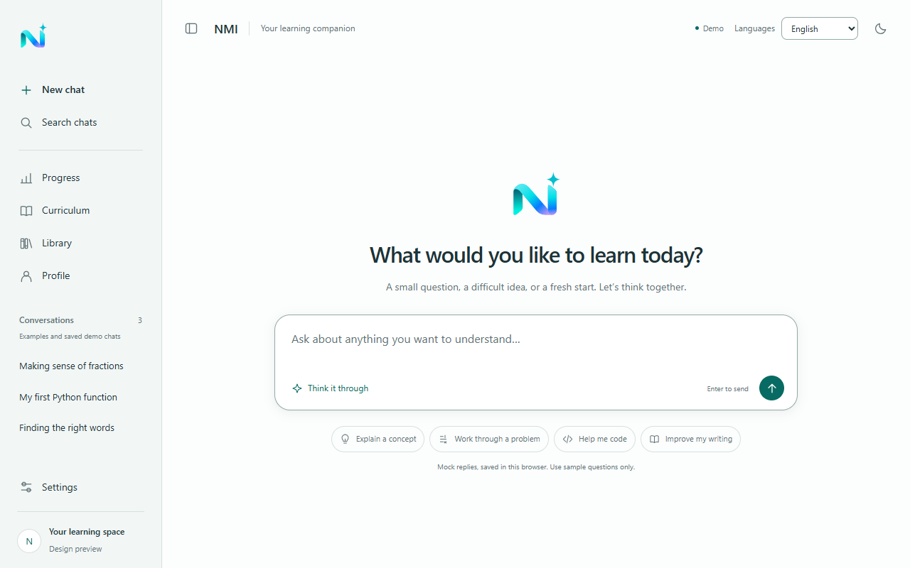
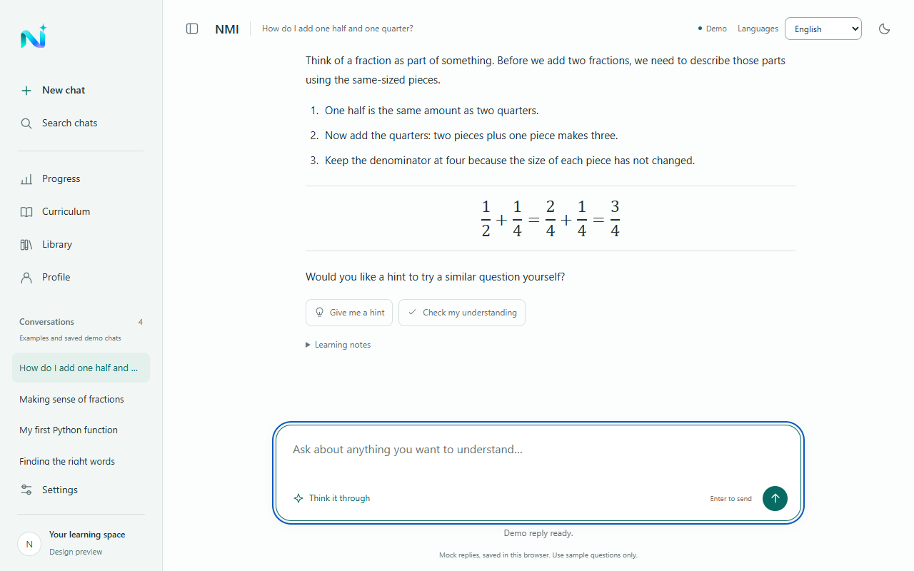
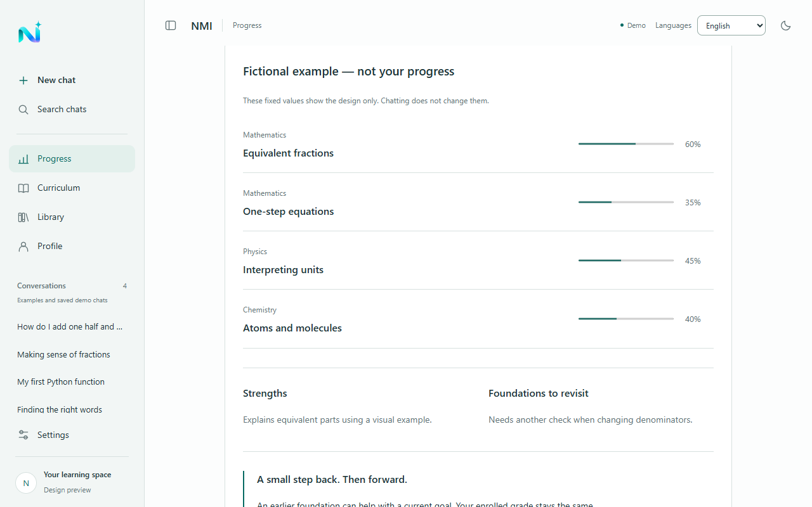

# NMI — Next Mastery Intelligence

**A free toolkit that turns ChatGPT, Claude or Gemini into a math tutor that knows the Israeli high-school curriculum and the shape of its exams.**

🔗 **Try it:** https://m0502223641-coder.github.io/NMI/ (works best on a phone)

---

## Why I built it

I built NMI because I had gaps in math. I needed to review grade 9 material on my own, really understand the topics I had skipped over, and reach a high level so I could move up to 5-unit math.

I used ChatGPT to study, but without the right instructions it scattered me. It did not know the Israeli curriculum, and it did not know the patterns of our exam questions:
- which topics are in **my** grade and level, and which are not;
- what our exam questions look like (a story, sections that build on each other, a "justify" section);
- that it should let me try first instead of solving for me.

So I decided to build NMI.

At first I planned NMI for students in every country. I soon found that each country has its own curriculum and its own exams, and doing it right would take months. So I focused on one curriculum I know and can check: Israel.

Building it was an amazing journey, and I was excited the whole time. But when I finished, I asked myself one question: **"Is a student ready to leave ChatGPT, Claude or Gemini and move to my website?"** The answer was no.

So I asked a better question: **why not bring NMI inside the AI tools students already use?**

## The solution

NMI brings the curriculum **into** the app the student already uses.

1. The student picks a subject, grade, level (3, 4 or 5 units) and an optional target level (for example 3 → 5).
2. The student ticks the topics to review, or adds a topic of their own.
3. The student picks one or more modes: **Understand**, **Practice**, **Mock exam**, **Plan**. Optional: "I have an old exam from my teacher", "Remind me of my old mistakes", and a short note to the tutor.
4. NMI builds one prompt and opens the student's AI app with it (Android share sheet, or copy and paste).
5. At the end of a session, the AI writes a short summary. The student pastes it into **My log** in NMI, and the next prompt can test them on their old mistakes.

The page is in Arabic, Hebrew and English. The prompt tells the AI to answer in the student's language, with the Hebrew math terms.

The prompt contains only what that student needs: their topics from the official curriculum, the exam patterns for their level, one example question per topic, and the teaching rules (one question at a time, hints before answers, read photos of handwritten work).

**The prompt contains no real exam.** It describes the shape of the exam, and the AI writes new questions in that shape.

Nothing is uploaded to NMI. The mistakes log stays only on the student's phone. There is no server and no cost.

## What is inside

| Part | What | How it was checked |
|---|---|---|
| Curriculum | 9 levels: grades 10, 11, 12 × 3, 4, 5 units, in Arabic | Topic lists compared line by line with the Ministry of Education teaching recommendations for 2026–2027 and the new curriculum document |
| Exam patterns | 7 exam forms (35172, 35371, 35372, 35471, 35472, 35571, 35572): structure, typical sections, common traps | Built from official Ministry exams; no exam question is copied |
| Example bank | 101 exam-style questions, one per topic, with new stories and numbers | Every number checked with SymPy; stories checked for sense (no negative prices or lengths) |
| Teaching rules | Explain / practice / mock exam / plan, a hint ladder, photo reading, memory methods from learning science (retrieval, spacing, interleaving), and teaching methods inspired by research at Oxford (tutorials), MIT (active learning), Stanford (Jo Boaler) and Harvard (Peer Instruction) | Tested first in a lab version (below) |

## How it was built

- **Lab version (first):** a local web app that called the Claude API directly, with 60+ evaluation cases scored by an AI judge and by code checks. It taught me which teaching rules work. It also taught me that students would not leave ChatGPT for it, so the product became the toolkit.
- **Toolkit (now):** a static page (`kit/`) built from the curriculum files by `tools/build_kit.py`. Adding a subject means adding its curriculum files and its own base prompt; the rest of the code stays the same.
- **Tests:** 192 offline tests, 77 local tests, 53 prompt tests, 9 log tests, 12 text tests, 139 browser tests of the kit on iPhone, Android and desktop sizes, and 44 browser tests of the lab demo.
- **Tools:** I designed the product, made the decisions and tested it with real study sessions. I wrote the code with AI coding assistants (Claude Code), and checked the content against official sources.

## The lab version

The first version of NMI was a full tutoring website that ran on my computer and talked to the Claude API. The real version is not online, because it needs a server and a paid API key. A demo with made-up replies is online, and these screenshots are from it.

You can try the demo online: https://m0502223641-coder.github.io/NMI/lab/


*The start screen: a calm chat window with a sidebar for progress, curriculum and saved conversations, and sample questions to begin with.*


*A tutoring reply in demo mode: numbered steps, the worked equation, and buttons to ask for a hint or check understanding.*


*The progress screen with a fictional example: a mastery bar for each skill, strengths, and foundations to revisit.*

## What I learned

- **Do not just copy and paste from AI.** I started this project to learn programming and become a programmer. But I got tempted by how good the AI tools were, and my work became just copy and paste. Then I asked myself: why did I build this app in the first place? Wasn't my goal to learn programming and become a programmer? So I decided to let the AI write the code, while I understand the commands and how the system is built, so that if something breaks on the site, I know where the problem is without any help from AI. Building the site taught me a lot.
- **Think about the problem before building.** Ask if the user really needs it, or if they will just go to a better alternative. And do not start just because I am excited.
- **AI makes confident mistakes.** An AI assistant gave me a wrong exam form number, and my first kit prompt had 6 errors. Now I check everything against official sources.
- **Test the real thing, not only the tests.** All tests passed, but some mistakes showed only when I looked at the real prompt on my phone.
- **Small and checked beats big and unchecked.** One subject done well is better than three subjects half done.

## Honest limits

- The curriculum and exam patterns follow official documents, but **no math teacher has reviewed** the example bank yet.
- Common mistakes listed per topic come from general teaching experience, not from the Ministry.
- Some 4- and 3-unit patterns (35372, 35471) were built from the matching graduates' exams.
- Opening the installed app directly works on Android; on iPhone the student pastes the prompt.
- The Hebrew and English page texts were written with AI and checked by me, not by a professional translator.
- 24 of the 101 topics have no Hebrew name in the curriculum files yet, so they show in Arabic on the Hebrew and English page.
- The lab demo was built for computers; on a phone it shows zoomed out.

## Next

- Physics (experimental first), then English. A new subject needs its own curriculum files and its own base prompt; the rest of the code stays the same.
- A grade 9 level for students who miss the basics.
- A review of the example bank by a math teacher.

## Repository map

```
kit/                 the toolkit page (index.html, app.js, prompt.js, log.js, i18n.js, data.json)
kit/applinks.html    a test page for opening the apps on Android (not linked)
preview/             the lab demo, published under /lab/
curriculum/math/     curriculum files, exam patterns, example bank
tools/build_kit.py   builds kit/data.json from curriculum/
tests/               offline, local, prompt and browser tests
docs/KIT.md          publishing and manual phone checks
docs/lab/            screenshots of the lab version
(other files)        the lab version
```
